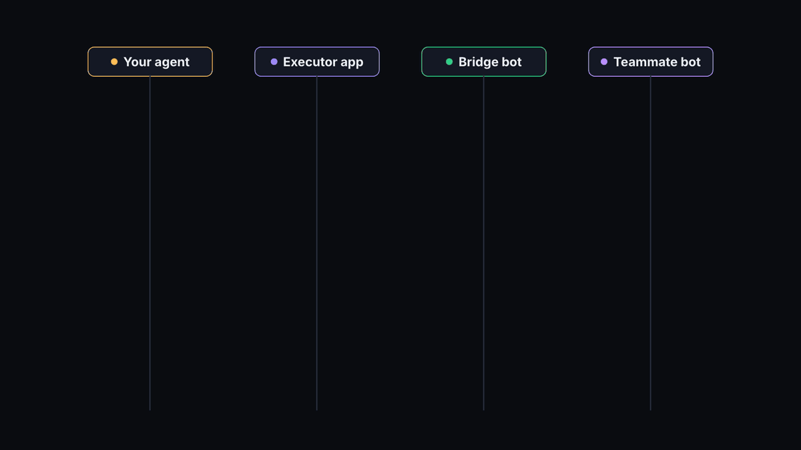
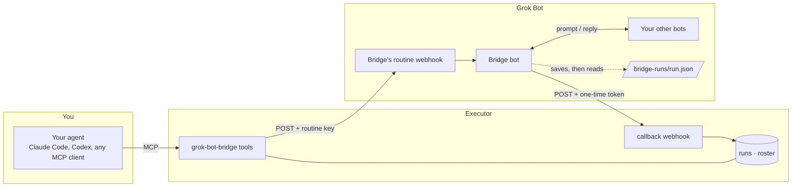
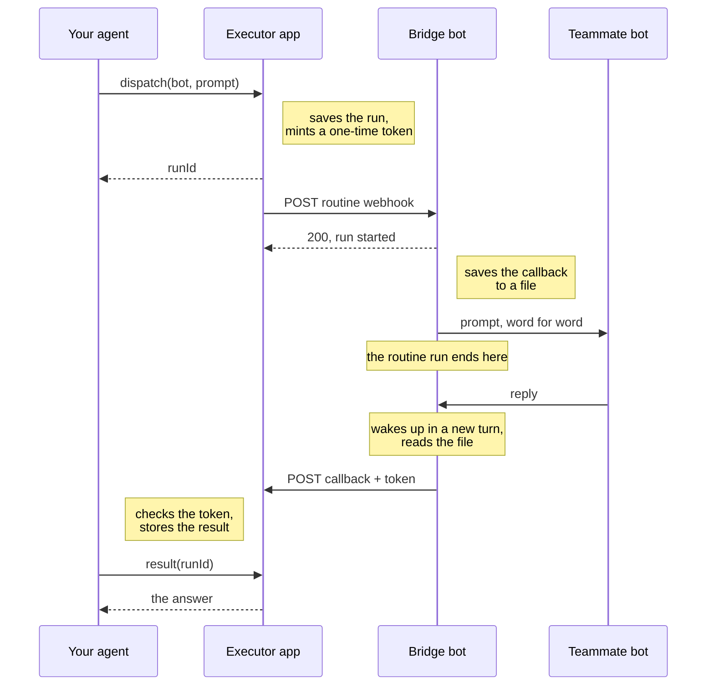
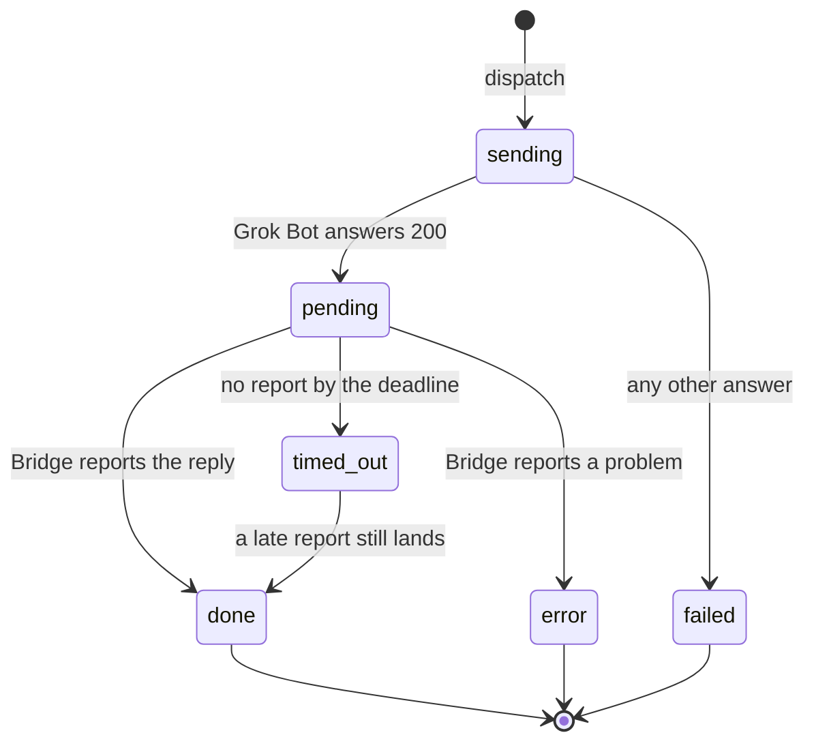

# Grok Bot Bridge

Send a prompt to any of your Grok Bot teammates from code, and read the answer back.



Grok Bot has no API for messaging a bot. This is an [Executor](https://executor.sh) app plus one
extra bot that gives you one anyway: `dispatch("Researcher", "…")` from Claude Code, Codex or any
MCP client, then `result(runId)` when the bot has answered.

> [!WARNING]
> Whoever can call `dispatch` can make your bots act with every permission those bots have: your
> mail, your calendar, your repos. Install this only in an Executor you control, and read
> [Security](#security) first.

> [!NOTE]
> This leans on Grok Bot behavior its docs don't promise. It worked on 2026-11-10 and may stop
> working any day. If xAI ships a real API, use that instead.

## Why this exists

The one thing Grok Bot lets you call from code is a routine's webhook. You POST to it with a key,
and it answers `200` to say a run started. That's all:

- The answer never comes back on that HTTP response.
- There is no API to read the bot's chat, list your bots, or look a run up later.
- A webhook belongs to one routine on one bot, so reaching ten bots means ten webhooks.

The bridge closes all three gaps with a router bot called Bridge. One webhook reaches every bot you
have, and Bridge posts each answer back to a place your code can read.

## Why Executor

The bridge needs four things, and Executor already has them:

- **A safe place for the webhook key.** It sits in Executor's account store, never in a prompt, a
  repo or a chat.
- **A public callback URL.** Bridge needs somewhere to POST the answer. Executor gives each app a
  webhook address without you running a server.
- **Storage.** Runs and the cached roster live in the app's own SQLite database.
- **Tools for any agent.** Executor exposes the app over MCP, so every agent you use gets
  `dispatch` and `result` without a plugin per client.

## Quick start

You need an Executor (self-hosted or cloud) and Grok Bot.

1. **Deploy the app.** From this repo: `executor apps create --name "Grok Bot Bridge" --files app`.
   Note the app id it prints (`app_…`).
2. **Add the Bridge bot.** Use the [shared template](https://x.ai/bot/gw3MZ95iQeCdCR7nR8rSp), or
   paste prompt 1 from [template/router-bot.md](template/router-bot.md) into your main bot.
3. **Give Bridge its routine.** Paste prompt 2 from the same file into Bridge's own chat, with your
   callback address filled in. A bot can only create routines on itself, so this step is yours.
4. **Link the two.** Open Bridge's routine on desktop, copy **POST to** and **key**, and paste them
   into the app's `router` account in Executor.
5. **Test it.** Call `refreshTeammates`, then `result` with the run id it returned. `done` means the
   whole loop works.

## Using it

```js
const { runId } = await tools["grok-bot-bridge"].dispatch({
  target: "Researcher",
  prompt: "What changed in the EU AI Act this month? Three bullets, with sources.",
});

// The bot takes as long as it takes. Read the run until it leaves `pending`.
const run = await tools["grok-bot-bridge"].result({ runId });
// { status: "done", result: "…the bot's answer, word for word…" }
```

The prompt arrives word for word and the bot can't ask you follow-up questions, so make it
self-contained. Use `teammates` to see who you can send to.

| Tool               | What it does                                                                   |
| ------------------ | ------------------------------------------------------------------------------ |
| `dispatch`         | Send `prompt` to the teammate named `target`. Returns `runId` at once.         |
| `result`           | Read one run by `runId`.                                                       |
| `runs`             | Recent runs, newest first, with results cut to 280 characters.                 |
| `teammates`        | The cached roster: name, description, what each bot handles.                   |
| `refreshTeammates` | Ask Bridge for the current roster. Returns a `runId`.                          |
| `status`           | Check the setup: callback registered, webhook host, roster age, runs by state. |
| `report`           | Record a run's outcome. Only for a Bridge bot that has this app as a tool.     |

## How it works

### Where everything lives



### One dispatch, step by step



The two-turn shape is the part that isn't obvious. A Grok Bot routine run ends the moment the bot
messages another bot, so Bridge can't wait for the answer inside it. It saves the run's callback
address and token to a file first. The teammate's reply then wakes Bridge in a fresh turn, which
reads the file, posts the answer and deletes the file.

The roster is simpler. `refreshTeammates` asks Bridge for the list of your bots, Bridge reports it
from inside the webhook run, the app caches it, and `teammates` serves the cache instantly.

### What a run can be



- `sending`: the webhook call is in flight.
- `pending`: Grok Bot accepted the call and the run started.
- `done`: the teammate's answer is stored.
- `error`: Bridge reported a problem, such as an unknown teammate.
- `failed`: Grok Bot did not start a run. The routine is paused or the key is stale.
- `timed_out`: no report arrived before the deadline, 30 minutes unless you pass `timeoutMinutes`.
  It isn't stored; the app works it out when you read the run.

## What a live test showed

Tested on 2026-11-10 against a self-hosted Executor behind Cloudflare, with a Bridge bot that is
not the primary bot. Treat all of it as observed, not guaranteed.

- **A dispatch makes the full round trip.** Trivial prompts went agent to app to Bridge to the
  target bot and back in 44 and 47 seconds, unattended, with the answer stored word for word.
- **A roster run works unattended.** It reported back in 1 minute 39 seconds with no approval card.
- **A non-primary bot can delegate.** Bridge messaged the target bot directly from inside the
  webhook run, and the target replied in that thread.
- **A routine run ends when the bot messages another bot.** The reply arrives in a later turn that
  no longer has the webhook body. That is why Bridge saves each run to a file before handing over.
- **The webhook answer carries a run id.** Grok Bot answers `{"success":true,"runUuid":"..."}`.
  The app keeps it in `webhookReply`; there is still no API to look that run up.
- **Cloudflare refuses Python's urllib.** A callback sent with the default `Python-urllib` user
  agent gets HTTP 403 `error code: 1010` and never reaches the app. curl and other common clients
  pass. The routine tells the bot to use curl or set its own user agent.

Not tested yet: several dispatches at once, a teammate that takes many minutes, and a teammate that
never replies.

## Limits

- Grok Bot allows 200 runs an hour per routine and 300 across all your routines. Every dispatch
  and roster refresh is one run, and they all share Bridge's one routine.
- A prompt is at most 100,000 characters and a callback body at most 1 MiB.
- Grok Bot has no status API, so the app can't tell a slow teammate from a run that died.
  `timed_out` covers both.
- The `roster` schedule refreshes the roster daily. Schedules start paused in Executor.
- Deploying a new version gives the app a new callback URL and stops the old one. A run that is
  still pending at that moment can no longer report and ends as `timed_out`. Deploy when nothing
  is in flight.

## Security

- **Dispatch is remote control of your bots.** A prompt sent through the bridge runs with the
  target bot's access. The app runs per Executor user, with that user's linked Bridge bot, so
  access to your Executor is access to your bots.
- **The routine's key** lives in Executor's account store and is pinned to `*.cursor.sh`, the host
  Grok Bot serves routine webhooks from. App code only ever holds a handle; Executor swaps in the
  real key on requests to that host and nowhere else.
- **Each run gets its own random token.** The app stores only its SHA-256 digest and accepts one
  report per run, so a leaked token can't rewrite a finished run or touch another one.
- **Bridge posts to one place.** Its routine refuses any callback URL outside the prefix written
  into its instruction, which is your Executor's address for this app.
- **Between hand-over and reply, a run's token sits in a file** under `/workspace/bridge-runs/` on
  the bots' shared computer, where your other bots can read it. It completes that one run and
  nothing else, and Bridge deletes it once the report is accepted.
- **A prompt is untrusted text to the bot that receives it.** Bridge is told to treat webhook
  bodies and replies as data, but a model following instructions is not a hard boundary.

## Development

The app lives in `app/`. Executor deploys that directory and nothing else.

```sh
cd app
npm install --no-package-lock
npm run typecheck
npm run check
npm test
```

Deploy with the Executor CLI from the repo root:

```sh
executor apps create --name "Grok Bot Bridge" --files app   # first time
executor apps deploy --app <app-id> --files app              # every change
```

`apps` is pinned to the version the host runs; `executor apps framework` prints it. The wire
contract lives in `app/src/protocol.ts` and, in words, in `template/router-bot.md`. Change them
together.

The animation at the top is a [HyperFrames](https://hyperframes.heygen.com) composition in
`media/film/`. `npm run render` there writes an MP4; the GIF is that render scaled to 1200 px.

## License

[MIT](LICENSE)
